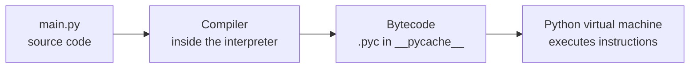

# How Python runs

## What "Python" is?

Python is not only a programation language, it is a program (the interpreter) that render your code - your `.py` file, compiles it to bytecode and run that code a a virtual machine. So installing python it's installing that program + the libraries of that program.

## From source code to execution



- the main interpreter is called `CPython` (written in C). When people say Python, it's Cpython.

- In python compalation is automatic, you don't not have to compile your program. 

## Several Pythons on one machine
you can have multiple python in one machine, like on your mac.
let's say we have a version of python (a version, because, its a program) 3.13 -> you can also install 2.1 or 3.15. those programs comes with their own new stuffs. sometimes the syntax is updated, sometimes the interpreter is improved to be faster or whatever.

BUT if you write a python application. HOW do you know which program (python) do you use? for later : virtual environements.

## How `import` finds a module
To be seen wayyyy later.


## Commands we ran

we will see this later also.

```bash
# one comment would be

uv init # create the env
uv sync # sync ...
uv add # add library to the environement
uv run 'your file' # run the code in this environement

```

https://docs.astral.sh/uv/